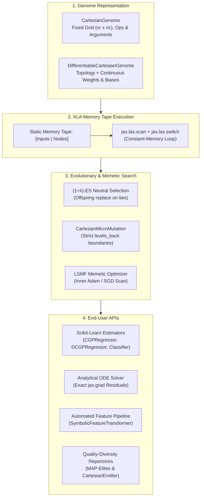

# Malthus-GP: JAX-Native Genetic Programming & Differentiable Symbolic Discovery

[](https://github.com/google/jax)
[](https://www.python.org/)
[](https://opensource.org/licenses/MIT)
[](https://github.com/astral-sh/ruff)

**`malthus-gp`** is a modular, high-performance Genetic Programming (GP) package built on JAX and MalthusJAX. It provides accelerated graph, linear, and differentiable evolutionary algorithms that compile with `@jax.jit` and execute across CPUs, GPUs, and TPUs with constant-memory XLA execution tapes.

---

## Highlights

- **Cartesian Genetic Programming (CGP)**: Feed-forward DAG graph representations (Miller & Thomson, 2000) that eliminate tree code bloat and enable natural subgraph reuse.
- **Differentiable Genetic Programming (dCGP / dCGPANN)**: Continuous edge weights and node biases optimized via JAX AutoDiff and the LSMF memetic algorithm (Izzo et al., 2016; Märtens & Izzo, 2019).
- **Symbolic ODE Residual Solving**: Closed-form analytical ordinary differential equation solvers using exact `jax.grad` derivatives without numerical discretization error.
- **Active Neutral Drift Dynamics**: True $(1+\lambda)$-ES evolutionary strategy prioritizing offspring on fitness ties, allowing neutral search through non-coding regions to escape local optima.
- **XLA Tape-Based Execution**: Evaluates candidate DAG programs using `jax.lax.scan` and `jax.lax.switch` on pre-allocated static tensors—zero branch divergence and constant memory footprint.
- **Scikit-Learn Compatible Estimators**: Drop-in `CGPRegressor`, `DCGPRegressor`, `CGPClassifier`, `CGPODESolver`, and `SymbolicFeatureTransformer` supporting `.fit(X, y)` and `.predict(X)`.

---

## Architectural Overview



---

## Framework Comparison

| Feature | `malthus-gp` | Kozax | PySR | gplearn | DEAP |
| :--- | :---: | :---: | :---: | :---: | :---: |
| **JAX-Native (`jit` / `vmap`)** | **Yes** | **Yes** | No (Julia) | No (NumPy) | No (Python) |
| **Program Representation** | **Cartesian DAG** | Parse Tree | Parse Tree | Parse Tree | Parse Tree |
| **Differentiable (dCGP)** | **Yes (Optax)** | No | No | No | No |
| **Analytical ODE Discovery** | **Yes (`jax.grad`)** | No | No | No | No |
| **Neutral Drift Selection** | **Yes** | No | No | No | No |
| **Intrinsic Subgraph Reuse** | **Yes (DAG)** | No | No | No | No |
| **Scikit-Learn Estimators** | **Yes** | No | Yes | Yes | Yes |
| **Memory Allocation** | **Static Tape** | Dynamic Tree | Stack Engine | NumPy Array | Object Tree |

---

## Installation

```bash
# Editable install from workspace
pip install -e packages/malthus_gp

# With scikit-learn estimator support
pip install -e "packages/malthus_gp[learn]"

# With full developer and test dependencies
pip install -e "packages/malthus_gp[all]"
```

---

## Quick Start Examples

### 1. Classical Symbolic Regression (Koza-1)

```python
import numpy as np
from malthus_gp.learn import CGPRegressor

# Generate dataset: y = x^4 + x^3 + x^2 + x
X = np.linspace(-1, 1, 40).reshape(-1, 1)
y = (X**4 + X**3 + X**2 + X).flatten()

# Initialize and fit CGP Regressor
model = CGPRegressor(
    n_rows=1,
    n_cols=30,
    levels_back=-1,
    pop_size=5,
    max_generations=500,
    mutation_rate=0.04,
    random_state=42,
)
model.fit(X, y)

# Predict, score, and decode formula
print("Score (R²):", model.score(X, y))
print("Evolved formula:", model.to_formula())
print("Active graph mask:", model.get_active_mask())
```

### 2. Differentiable Memetic Regression (dCGP + LSMF)

```python
from malthus_gp.learn import DCGPRegressor

# Target with non-trivial floating-point coefficients: y = 2.45*x^3 - 1.82*x^2 + 0.65*x - 0.35
model = DCGPRegressor(
    n_rows=1,
    n_cols=20,
    pop_size=5,
    max_generations=150,
    lsmf_epochs=15,      # 15 inner Adam gradient steps per individual
    learning_rate=0.03,  # Continuous parameter learning rate
    random_state=42,
)
model.fit(X, y)
print("Score (R²):", model.score(X, y))
print("Formula with continuous weights:", model.to_formula())
```

### 3. Closed-Form Analytical ODE Discovery

```python
from malthus_gp.learn import CGPODESolver

# Initial value problem: dy/dt = -y, y(0) = 1 (Analytical truth: y(t) = exp(-t))
def decay_ode(t, y):
    return -y

solver = CGPODESolver(
    ode_fn=decay_ode,
    initial_condition=(0.0, 1.0),
    t_domain=np.linspace(0.0, 2.5, 50),
    n_cols=25,
    pop_size=5,
    max_generations=400,
    random_state=42,
)
solver.fit()

print("Discovered closed-form solution:", solver.to_formula())
```

### 4. Automated Feature Synthesis in Scikit-Learn Pipelines

```python
from sklearn.pipeline import Pipeline
from sklearn.linear_model import Ridge
from malthus_gp.learn import SymbolicFeatureTransformer

# Automated pipeline: Non-linear mathematical feature synthesis + Ridge regression
pipe = Pipeline([
    ("sym_features", SymbolicFeatureTransformer(
        n_features=5,           # Synthesize 5 non-linear basis features
        include_original=True,  # Retain raw inputs
        redundancy_weight=0.5,  # Penalize collinear features
        max_generations=150,
        random_state=42,
    )),
    ("regressor", Ridge(alpha=1.0)),
])

pipe.fit(X_train, y_train)
print("Pipeline Test R² Score:", pipe.score(X_test, y_test))

# Inspect synthesized mathematical expressions
for i, formula in enumerate(pipe.named_steps["sym_features"].to_formula()):
    print(f"Feature φ_{i}: {formula}")
```

---

## Documentation & Comprehensive Guides

Detailed technical specifications, mathematical proofs, and user guides are available in the [`docs/`](docs/) directory:

- [**System Architecture & Execution Model**](docs/architecture.md): Deep-dive into memory tape layouts, XLA compilation, topological connection bounds, and PRNG key lineage.
- [**Guide 1: Cartesian GP Fundamentals**](docs/guides/01_cgp_fundamentals.md): Grid layout, $(1+\lambda)$-ES dynamics, neutral drift theory, and non-coding gene analysis.
- [**Guide 2: Differentiable CGP & LSMF**](docs/guides/02_differentiable_cgp_lsmf.md): Continuous parameters, Lamarckian evolution, and Optax Adam integration.
- [**Guide 3: Analytical ODE Solving**](docs/guides/03_analytical_ode_solving.md): Physics-informed symbolic discovery via exact `jax.grad` derivatives without numerical discretization grids.
- [**Guide 4: Scikit-Learn Integration**](docs/guides/04_scikit_learn_integration.md): Drop-in estimators, cross-validation, and automated pipeline feature engineering.
- [**Guide 5: Quality-Diversity in CGP**](docs/guides/05_quality_diversity_cgp.md): Illuminating program trade-off spaces with MAP-Elites and `CartesianEmitter`.
- [**Guide 6: CLI & Declarative TOML**](docs/guides/06_cli_and_toml_orchestration.md): Command-line reference (`mgp` / `mjax gp`) and multi-island execution.

---

## Runnable Showcase Scripts

The [`examples/`](examples/) directory contains production-ready demonstration scripts that execute end-to-end and generate diagnostic plots:

1. [`01_classical_cgp_benchmarks.py`](examples/01_classical_cgp_benchmarks.py): Solves Koza-1 and Nguyen-7 benchmark problems in under 2 seconds.
2. [`02_dcgp_memetic_learning.py`](examples/02_dcgp_memetic_learning.py): Compares classical discrete CGP vs. dCGP memetic optimization on continuous-coefficient polynomials.
3. [`03_closed_form_ode_discovery.py`](examples/03_closed_form_ode_discovery.py): Solves ordinary differential equations symbolically using AutoDiff.
4. [`04_sklearn_pipeline_synthesis.py`](examples/04_sklearn_pipeline_synthesis.py): Elevates linear model accuracy on tabular data via automated symbolic feature synthesis.

---

## Command-Line Interface (`mgp` / `mjax gp`)

`malthus-gp` installs the standalone `mgp` CLI tool and automatically registers with the unified MalthusJAX CLI (`mjax gp`):

```bash
# Train a model from CSV data
mgp fit --data data.csv --target y --model cgp_regressor --generations 500 --output model.toml

# Decode formula from saved model
mgp formula --model-toml model.toml

# Run inference on new data
mgp predict --model-toml model.toml --data new_features.npy --output predictions.npy
```

---

## Academic References

- Miller, J. F., & Thomson, P. (2000). *Cartesian genetic programming*. European Conference on Genetic Programming (EuroGP), 121-132.
- Izzo, D., Biscani, F., & Mereta, A. (2016). *Differentiable genetic programming*. Proceedings of the European Conference on Genetic Programming (EuroGP).
- Märtens, M., & Izzo, D. (2019). *The learn-select-mutate-forget (LSMF) algorithm for differentiable Cartesian genetic programming*. Proceedings of the Genetic and Evolutionary Computation Conference (GECCO).
- Koza, J. R. (1992). *Genetic programming: on the programming of computers by means of natural selection*. MIT Press.
