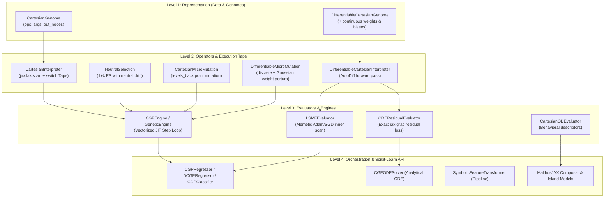

# Malthus-GP System Architecture & Execution Model

This document specifies the technical architecture, mathematical representation, and XLA compilation mechanics of **`malthus-gp`**, a JAX-native Genetic Programming framework.

---

## 1. Architectural Overview & Component Hierarchy

`malthus-gp` extends the core MalthusJAX 4-level abstraction architecture to graph-based and differentiable evolutionary algorithms:



---

## 2. Cartesian Graph Representation & Chromosome Layout

### 2.1 The 2-D Grid DAG Model

A program in Cartesian Genetic Programming (Miller & Thomson, 2000) is structured as a two-dimensional grid of $n_r$ rows and $n_c$ columns containing $n_{\text{nodes}} = n_r \times n_c$ computational nodes:

- **Primary Inputs**: External features $x_0, x_1, \dots, x_{N-1}$ are assigned virtual indices $[0, N)$.
- **Internal Nodes**: Numbered sequentially column-by-column starting from $N$ to $N + n_{\text{nodes}} - 1$.
- **Outputs**: An array of size $n_{\text{outputs}}$ containing pointers to any node or primary input index in $[0, N + n_{\text{nodes}})$.

```text
Inputs:        Column 0:          Column 1:                 Column c:
[0] x0 ------> [2] (op, [0, 1]) -> [4] (op, [2, 0]) ------> [N+i] (op, [arg0, arg1])
[1] x1 ------> [3] (op, [1, 0]) -> [5] (op, [3, 2])          │
                                                              ▼
                                                        Outputs: [out_0, ...]
```

### 2.2 Chromosome Tensor Layout

The `CartesianGenome` PyTree stores genomes as dense, fixed-shape NumPy/JAX integer tensors:

```python
@struct.dataclass
class CartesianGenome(BaseGenome):
    ops: chex.Array        # shape (num_nodes,)           int32 - Opcode index per node
    args: chex.Array       # shape (num_nodes, max_arity) int32 - Connection index pointers
    out_nodes: chex.Array  # shape (num_outputs,)         int32 - Output node pointers
```

In `DifferentiableCartesianGenome`, the topology is augmented with floating-point parameters:
```python
@struct.dataclass
class DifferentiableCartesianGenome(CartesianGenome):
    weights: chex.Array    # shape (num_nodes, max_arity) float32 - Continuous edge weights
    biases: chex.Array     # shape (num_nodes,)           float32 - Continuous node biases
```

---

## 3. Strict Topological Bounds & `levels_back` Locality

To prevent cyclical graphs and ensure valid feed-forward evaluation, nodes in column $c$ may only connect to:
1. External primary inputs: indices $[0, N)$.
2. Nodes located in preceding columns from $\max(0, c - l)$ to $c - 1$, where $l$ is `levels_back`.

### Connection Index Mapping

For each node index $i$, `CartesianGenomeConfig` precomputes valid connection bounds $[lo_i, hi_i)$:

$$lo_i = 0 \quad (\text{always includes primary inputs } [0, N))$$
$$hi_i = N + \text{col}(i) \times n_r$$

When mutating an argument gene of node $i$:
$$\text{arg}_{i, k} \sim \mathcal{U}\{lo_i, hi_i - 1\}$$

This mathematical guarantee eliminates runtime validity checks or repair operators, enabling 100% compliant JIT compilation.

---

## 4. XLA Constant-Memory Tape Execution

Classical tree-based GP libraries (DEAP, Kozax, gplearn) rely on recursive AST traversals or variable-length stacks. This causes dynamic branching, memory reallocations, and poor XLA optimization.

`malthus-gp` solves this with a **pre-allocated memory tape** executed via `jax.lax.scan` and `jax.lax.switch`:

```text
Memory Tape Layout:
┌──────────────────────┬────────────────────────────────────────────────────────┐
│ Inputs: [0 ... N-1]  │ Computed Node Values: [N ... N + num_nodes - 1]         │
└──────────────────────┴────────────────────────────────────────────────────────┘
```

### Step Function Specification

```python
def step(current_mem: chex.Array, node_data: Tuple[chex.Array, chex.Array, chex.Array]):
    op_code, arg_indices, write_idx = node_data

    # 1. Gather input activations from pre-allocated memory
    arg0 = current_mem[arg_indices[0]]
    arg1 = current_mem[arg_indices[1]]

    # 2. Execute primitive operation in a single XLA switch
    val = jax.lax.switch(op_code, self.functions, arg0, arg1)
    val = jnp.nan_to_num(val, nan=0.0, posinf=1e6, neginf=-1e6)

    # 3. Store result in write slot
    new_mem = current_mem.at[write_idx].set(val)
    return new_mem, None

final_mem, _ = jax.lax.scan(step, memory, (genome.ops, genome.args, write_indices))
outputs = jnp.take(final_mem, genome.out_nodes)
```

- **Time Complexity**: $\mathcal{O}(n_{\text{nodes}})$ static iterations unrollable by XLA.
- **Space Complexity**: $\mathcal{O}(N + n_{\text{nodes}})$ fixed pre-allocated scratch memory.
- **Vectorization**: Trivial batching over $B$ samples via `jax.vmap(evaluate_single, in_axes=(None, 0))`.

---

## 5. Differentiable AutoDiff & LSMF Memetic Search

In Differentiable Cartesian Genetic Programming (dCGP), each node computes:

$$N_i = \text{Activation}\left( \sum_{k=0}^{\text{arity}-1} w_{i, k} \cdot N_{\text{args}[i, k]} + b_i \right)$$

Because the forward pass is a continuous, differentiable computation graph, we compute exact gradients with respect to weights $w$ and biases $b$:

$$\nabla_w \mathcal{L} = \frac{\partial \mathcal{L}}{\partial w}, \quad \nabla_b \mathcal{L} = \frac{\partial \mathcal{L}}{\partial b}$$

### LSMF (Learn, Select, Mutate, Forget) Algorithm

Implemented in `LSMFEvaluator`:
1. **Learn**: Inside the JAX compilation graph, each individual executes $E$ inner Adam/SGD gradient descent steps via `jax.lax.scan`:
   $$(w^{(t+1)}, b^{(t+1)}) = \text{AdamStep}(w^{(t)}, b^{(t)}, \nabla \mathcal{L})$$
2. **Select**: Population fitness is evaluated after local learning (Lamarckian inheritance).
3. **Mutate**: Discrete topology (nodes, opcodes, arguments) undergoes point micro-mutation, while continuous weights undergo small Gaussian perturbations.
4. **Forget**: Optional weight re-initialization on neutral stagnation to escape continuous local minima.

---

## 6. Neutral Drift Dynamics & Tie-Breaking

A fundamental property of Cartesian GP is that a large percentage of nodes (often 70% to 90%) are **non-coding** (inactive in the final output path).

Standard selection strategies (e.g. tournament selection with strict $<$ comparisons) reject mutations to inactive nodes because the phenotype fitness remains unchanged. This causes search stagnation.

`NeutralSelection` enforces **active neutral drift**:
- When an offspring has fitness **equal to** the parent, the offspring **replaces the parent**.
- Mutations accumulate silently in inactive nodes, altering the genetic landscape until a subsequent mutation links an inactive sub-graph into the active phenotype.

### Vectorized Tie-Breaker Formulation

To execute neutral tie-breaking deterministically in JAX without Python branching:

$$\text{fitness}_{\text{tie}} = \text{fitness} - (\text{individual\_idx} \times 10^{-5})$$

During `jnp.argsort(fitness_tie)`, offspring (with indices $\ge 1$) systematically win ties over the parent (index 0).
