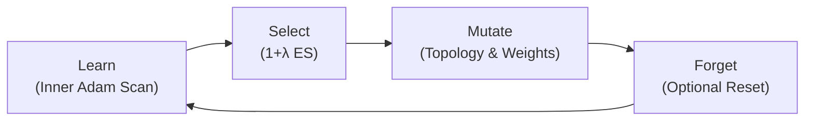

# Guide 2: Differentiable Cartesian GP (dCGP) & LSMF Memetic Search

This guide covers **Differentiable Cartesian Genetic Programming (dCGP)** and the **LSMF (Learn, Select, Mutate, Forget)** memetic algorithm (Izzo et al., 2016; Märtens & Izzo, 2019).

---

## 1. The Continuous Constant Problem in GP

Traditional symbolic regression faces an inherent limitation: **real-valued constant optimization**.

To fit a target like $y = 2.45 x^2 - 1.82$, discrete genetic programming must assemble mathematical approximations of constants out of discrete primitives (e.g. $(x/x + x/x) \times \dots$), causing immense formula bloat and slow convergence.

### The dCGP Solution

dCGP associates continuous edge weights $w$ and node biases $b$ with every connection in the graph:

$$N_i = \text{Activation}\left( \sum_{k=0}^{\text{arity}-1} w_{i, k} \cdot N_{\text{args}[i, k]} + b_i \right)$$

Because all mathematical primitives and activations are differentiable, we compute exact gradients of the dataset loss with respect to all continuous parameters via JAX AutoDiff:

$$\nabla_w \mathcal{L} = \frac{\partial \mathcal{L}}{\partial w}, \quad \nabla_b \mathcal{L} = \frac{\partial \mathcal{L}}{\partial b}$$

---

## 2. The LSMF Memetic Algorithm

The **LSMF** lifecycle synergizes global evolutionary search over discrete graph topologies with local gradient descent over continuous parameters:



1. **Learn**: Every generation, each candidate individual executes $E$ steps of Adam/SGD gradient descent inside a compiled JAX loop (`jax.lax.scan`).
2. **Select**: Lamarckian selection replaces parents using the improved fitness achieved through gradient descent.
3. **Mutate**: Discrete mutation alters graph connections and opcodes, while continuous mutation adds small Gaussian perturbations to weights.
4. **Forget**: Optional weight re-randomization prevents getting trapped in suboptimal continuous basins when the topology changes.

---

## 3. Code Example: Fitting Real-Valued Polynomials

```python
import numpy as np
from malthus_gp.learn import DCGPRegressor

# 1. Generate data with arbitrary real coefficients
np.random.seed(42)
X = np.linspace(-1.5, 1.5, 50).reshape(-1, 1)
y = 2.45 * (X[:, 0] ** 3) - 1.82 * (X[:, 0] ** 2) + 0.65 * X[:, 0] - 0.35

# 2. Configure Differentiable CGP Regressor
model = DCGPRegressor(
    n_rows=1,
    n_cols=20,
    pop_size=5,
    max_generations=150,
    lsmf_epochs=15,       # 15 gradient steps per individual per generation
    learning_rate=0.03,   # Adam learning rate for continuous parameters
    random_state=42,
)

# 3. Fit model
model.fit(X, y)

# 4. Inspect decoded formula with calibrated continuous weights
print(f"R² Score: {model.score(X, y):.5f}")
print("Discovered Formula:")
print(model.to_formula())
```

---

## 4. Activation Functions & Neural CGP (dCGPANN)

In addition to arithmetic functions, `malthus-gp` provides standard neural activation functions for evolving hybrid neural-symbolic architectures:

- `tanh`, `relu`, `sigmoid`, `elu`, `sin`, `linear`

These functions allow dCGP to act as a **sparse neural architecture search (NAS)** algorithm where both network connectivity and node activations evolve simultaneously.
