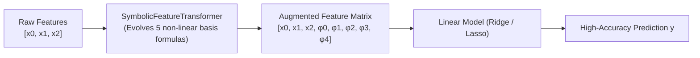

# Guide 4: Scikit-Learn Ecosystem & Feature Engineering

`malthus-gp` provides native compatibility with the **Scikit-Learn** API. All models inherit from `BaseEstimator`, enabling seamless integration with `Pipeline`, `GridSearchCV`, and cross-validation workflows.

---

## 1. Estimator Catalog

| Estimator | Subclass | Typical Use Case |
| :--- | :--- | :--- |
| **`CGPRegressor`** | `RegressorMixin` | Classical symbolic regression using discrete arithmetic primitives. |
| **`DCGPRegressor`** | `RegressorMixin` | Differentiable symbolic regression with continuous weights and Optax learning. |
| **`CGPClassifier`** | `ClassifierMixin` | Binary & multiclass classification using evolved decision boundaries. |
| **`SymbolicFeatureTransformer`** | `TransformerMixin` | Automated nonlinear feature synthesis for downstream linear/tree models. |

---

## 2. Automated Feature Engineering via `SymbolicFeatureTransformer`

Linear models (like Ridge or Lasso) and tree models (Random Forest, XGBoost) often struggle to model subtle multiplicative cross-terms (e.g. $x_0 \cdot x_1$) without manual domain engineering.

`SymbolicFeatureTransformer` evolves a bank of $K$ non-linear mathematical basis functions $\phi_0(X), \dots, \phi_{K-1}(X)$ that maximize correlation with the target $y$ while penalizing redundant mutual information:



### Complete Pipeline Example

```python
import numpy as np
from sklearn.pipeline import Pipeline
from sklearn.linear_model import Ridge
from sklearn.model_selection import train_test_split
from malthus_gp.learn import SymbolicFeatureTransformer

# 1. Dataset with non-linear cross terms
np.random.seed(42)
X = np.random.uniform(-2.0, 2.0, size=(250, 3))
y = 2.0 * X[:, 0] * X[:, 1] + np.sin(3.0 * X[:, 2]) - 1.5 * (X[:, 0]**2)

X_train, X_test, y_train, y_test = train_test_split(X, y, test_size=0.3, random_state=42)

# 2. Construct Automated Pipeline
pipeline = Pipeline([
    ("sym_features", SymbolicFeatureTransformer(
        n_features=5,            # Synthesize 5 non-linear features
        include_original=True,   # Keep original raw inputs [x0, x1, x2]
        redundancy_weight=0.5,   # Penalize correlated features
        max_generations=150,
        random_state=42,
    )),
    ("regressor", Ridge(alpha=1.0)),
])

# 3. Fit pipeline
pipeline.fit(X_train, y_train)

# 4. Evaluate performance
train_r2 = pipeline.score(X_train, y_train)
test_r2 = pipeline.score(X_test, y_test)
print(f"Pipeline Test R² Score: {test_r2:.4f}")

# 5. Inspect evolved mathematical representations
transformer = pipeline.named_steps["sym_features"]
for i, formula in enumerate(transformer.to_formula()):
    print(f"Synthesized Feature φ_{i}: {formula}")
```

---

## 3. Classification with `CGPClassifier`

`CGPClassifier` fits non-linear decision boundaries for classification tasks:

```python
from malthus_gp.learn import CGPClassifier

clf = CGPClassifier(
    n_rows=1,
    n_cols=25,
    max_generations=200,
    random_state=42,
)
clf.fit(X_train, y_train)
print(f"Classification Accuracy: {clf.score(X_test, y_test):.4f}")
```
