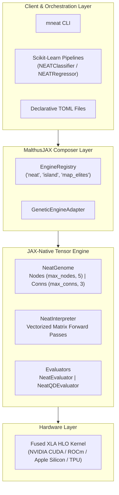

# `malthus-neat`

**Enterprise-Grade, Hardware-Accelerated Neuroevolution of Augmenting Topologies (NEAT) & QD-NEAT for JAX**

[](https://github.com/google/jax)
[](https://www.python.org/downloads/)
[](https://opensource.org/licenses/MIT)
[]()

`malthus-neat` delivers high-throughput, GPU-vectorized topology and weight-evolving neural networks. Built on top of **TensorNEAT** and **MalthusJAX**, it eliminates Python graph traversal overheads by mapping evolving neural graphs into **fixed-capacity, JIT-fusible static tensor buffers**.

It features full **Scikit-Learn estimator interoperability**, **Quality-Diversity (QD-NEAT / MAP-Elites)** illumination, **multi-island distributed architectures**, publication-quality visualization, and a production CLI (`mneat`).

---

## 1. Ecosystem Context & What `malthus-neat` Adds

`malthus-neat` bridges the gap between raw accelerated research code and standard production machine learning workflows:

- **[`NEAT-Python`](https://github.com/CodeReclaimers/neat-python)**: The classic CPU-bound Python implementation. While popular and versatile, it runs sequential Python loops over dynamic graph objects, making GPU/TPU acceleration impossible.
- **[`TensorNEAT`](https://github.com/EMI-Group/tensorneat)** (*GECCO 2024 Best Paper*, [arXiv:2404.01817](https://arxiv.org/abs/2404.01817)): Pioneered the mathematical tensorization of NEAT graphs into fixed-capacity matrices, unlocking massive JAX/GPU acceleration primarily for reinforcement learning (Brax / Gymnax).
- **`malthus-neat`**: Builds directly on top of `TensorNEAT`'s tensorized genome representations and integrates them into the **`MalthusJAX`** ecosystem, adding Scikit-Learn estimators, Quality-Diversity MAP-Elites, multi-island distributed search, TOML persistence, and a production CLI.

### Feature Comparison Matrix

| Capability | `NEAT-Python` (Legacy) | `TensorNEAT` (GECCO 2024) | `malthus-neat` (Ours) |
|:---|:---:|:---:|:---:|
| **Hardware Acceleration** | None (CPU only) | GPU / TPU / CPU (JAX) | **GPU / TPU / CPU (XLA)** |
| **Vectorized Population Execution** | Sequential Python loop | Vectorized JIT | **Nested `jax.vmap` batching** |
| **Scikit-Learn API (`fit` / `predict`)** | None (custom loops) | None (research RL API) | **`NEATClassifier` & `NEATRegressor`** |
| **Quality-Diversity (QD-NEAT)** | Third-party hacks | Not supported | **Native MAP-Elites & 2D Descriptors** |
| **Multi-Island Distributed Search** | Manual multiprocessing | None | **Native `island_neat` & migration** |
| **Auditable Model Persistence** | Python `pickle` | Raw checkpoint arrays | **Human-readable, versioned TOML** |
| **CLI & Batch Orchestration** | None | None | **Production `mneat` executable** |
| **Visual Diagnostic Subplots** | Graphviz dependency | Basic Matplotlib | **Subplot integration + Graphviz DOT** |

---

## 2. Architecture & Execution Flow



Read the full technical specification in [Architecture & Systems Design](docs/architecture.md).

---

## 3. Quickstart: 60 Seconds to Evolved Networks

### Classification (`NEATClassifier`)
```python
import numpy as np
from malthus_neat.learn import NEATClassifier

# XOR truth table
X = np.array([[0.0, 0.0], [0.0, 1.0], [1.0, 0.0], [1.0, 1.0]], dtype=np.float32)
y = np.array([0, 1, 1, 0], dtype=np.int32)

# Start minimal and complexify
clf = NEATClassifier(
    pop_size=50,
    max_generations=60,
    max_nodes=8,
    max_conns=16,
    random_state=42,
)
clf.fit(X, y)

print(f"Accuracy: {clf.score(X, y) * 100:.1f}%")
print(f"Evolved Synapses: {clf.best_genome_.num_active_conns}")
```

### Regression (`NEATRegressor`)
```python
import numpy as np
from malthus_neat.learn import NEATRegressor

# Non-linear curve fitting
X = np.linspace(-2.0, 2.0, 60).reshape(-1, 1).astype(np.float32)
y = (np.sin(2.5 * X[:, 0]) + 0.5 * X[:, 0]).astype(np.float32)

reg = NEATRegressor(
    pop_size=60,
    max_generations=100,
    max_nodes=16,
    max_conns=32,
    random_state=42,
)
reg.fit(X, y)

print(f"R² Score: {reg.score(X, y):.4f}")
```

---

## 4. Curated Showcases & Generated Diagnostics

The `examples/` directory contains four standalone, production-grade showcases generating publication-ready figures in `examples/plots/`:

| Showcase Script | Domain | Highlights & Diagnostic Figures |
|:---|:---|:---|
| [`01_xor_minimal_topology.py`](examples/01_xor_minimal_topology.py) | Non-Linear Binary Logic | Evolving XOR from zero hidden nodes; decision contour vs. minimal circuit diagram. |
| [`02_multiclass_classification.py`](examples/02_multiclass_classification.py) | Multiclass Classification | 3-class concentric rings; dual-output softmax decision landscape vs. evolved network. |
| [`03_regression_curve_fitting.py`](examples/03_regression_curve_fitting.py) | Non-Linear Curve Fitting | Oscillatory function approximation ($R^2 > 0.95$); continuous curve vs. topology. |
| [`04_qd_neat_repertoire.py`](examples/04_qd_neat_repertoire.py) | Quality-Diversity (QD-NEAT) | MAP-Elites archive in 2D descriptor space (density vs. prediction spread) vs. elite topology. |

Run any showcase:
```bash
python packages/malthus_neat/examples/01_xor_minimal_topology.py
python packages/malthus_neat/examples/02_multiclass_classification.py
python packages/malthus_neat/examples/03_regression_curve_fitting.py
python packages/malthus_neat/examples/04_qd_neat_repertoire.py
```

---

## 5. In-Depth Documentation Index

Explore the comprehensive guides located in [`docs/guides/`](docs/guides/):

- **[Architecture & Systems Design](docs/architecture.md)**: Buffer schemas `(max_nodes, 5)` & `(max_conns, 3)`, XLA kernel fusion, and vectorized matrix forward passes.
- **[Guide 1: NEAT Fundamentals](docs/guides/01_neat_fundamentals.md)**: Complexification from minimal topologies, historical markings, and speciation dynamics.
- **[Guide 2: Topology Growth & Mutation](docs/guides/02_topology_growth_and_mutation.md)**: Add connection, split edge (node insert), weight perturbation, and deterministic innovation tracking.
- **[Guide 3: Scikit-Learn Estimators](docs/guides/03_scikit_learn_estimators.md)**: `NEATClassifier` and `NEATRegressor` APIs, pipeline chaining, and TOML persistence.
- **[Guide 4: Quality-Diversity (QD-NEAT)](docs/guides/04_quality_diversity_qd_neat.md)**: Illuminating phenotypic space with MAP-Elites, Voronoi repertoires, and multi-island QD.
- **[Guide 5: Topology Visualization](docs/guides/05_topology_visualization.md)**: Subplot integration with `plot_network()`, Graphviz vector exports, and NetworkX analysis.
- **[Guide 6: CLI & TOML Orchestration](docs/guides/06_cli_and_toml_orchestration.md)**: The `mneat` CLI reference (`fit`, `predict`, `visualize`, `export-toml`) and declarative workflow setup.

---

## 6. CLI Reference (`mneat`)

Malthus-NEAT ships with the `mneat` executable for rapid CLI experimentation:

```bash
# Fit a classifier on CSV data using MAP-Elites
mneat fit \
  --data dataset.csv \
  --target label \
  --estimator classifier \
  --engine map_elites \
  --engine-params num_centroids=40 \
  --pop-size 80 \
  --generations 100 \
  --output model.toml \
  --visualize-out topology.png

# Generate predictions from saved model TOML
mneat predict \
  --model model.toml \
  --data new_features.csv \
  --output predictions.csv

# Render saved model to vector SVG
mneat visualize \
  --model model.toml \
  --output architecture.svg \
  --format svg
```

---

## 7. Testing & Verification

Run the test suite across unit, integration, and QD tests:

```bash
# Run all 45 test suites
python -m pytest packages/malthus_neat/tests --no-cov -v

# Run lint and code style checks
ruff check packages/malthus_neat/
ruff format --check packages/malthus_neat/
```
