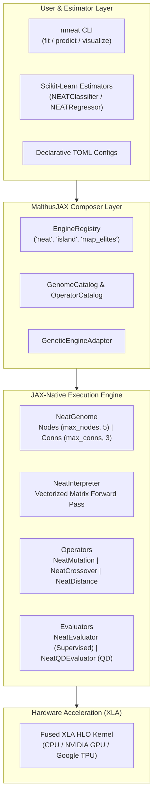
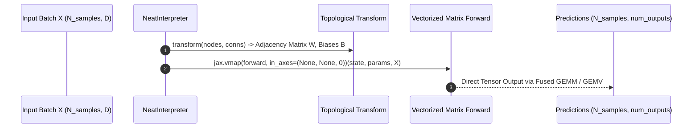

# Malthus-NEAT Architecture & Systems Design

`malthus-neat` is an enterprise-grade, JAX-accelerated neuroevolution framework implementing **Neuroevolution of Augmenting Topologies (NEAT)** and **Quality-Diversity NEAT (QD-NEAT)**. It eliminates Python interpreter bottlenecks, graph traversal overheads, and dynamic memory allocations by mapping evolving neural network topologies into **static, JIT-fusible tensor buffers**.

---

## 1. High-Level Architecture Overview

Malthus-NEAT integrates the high-performance tensorized genome primitives of `TensorNEAT` into the modular evolutionary ecosystem of `MalthusJAX`.



---

## 2. Tensorized Genome Buffer Model

Standard implementations of NEAT (such as `NEAT-Python`) represent networks as dynamic linked lists of Python objects, making vectorized GPU evaluation impossible. Malthus-NEAT uses **static tensor buffers** padded with `NaN` markers to represent topological structure:

### 2.1 Node Buffer: Shape `(max_nodes, 5)`
Each node in the network corresponds to a row in the `nodes` float32 matrix:

| Index | Field | Description | Inactive Marker |
|:---:|:---|:---|:---:|
| `0` | **Node Key / ID** | Unique innovation identifier for the neuron. | `NaN` (if slot is inactive) |
| `1` | **Node Type** | Categorical type: `0 = Input`, `1 = Bias`, `2 = Hidden`, `3 = Output`. | `NaN` |
| `2` | **Activation Function** | Mathematical activation identifier (e.g., `sigmoid`, `tanh`, `relu`). | `NaN` |
| `3` | **Aggregation Type** | Aggregation logic (e.g., `sum`, `product`, `max`). | `NaN` |
| `4` | **Bias Parameter** | Learnable scalar bias weight added to neuron input. | `NaN` |

### 2.2 Connection Buffer: Shape `(max_conns, 3)`
Each directed synapse corresponds to a row in the `conns` float32 matrix:

| Index | Field | Description | Inactive Marker |
|:---:|:---|:---|:---:|
| `0` | **Source Node Key** | Identifier of the transmitting neuron. | `NaN` (if slot is inactive) |
| `1` | **Target Node Key** | Identifier of the receiving neuron. | `NaN` (if slot is inactive) |
| `2` | **Synaptic Weight** | Learnable scalar weight value $w_{ij}$. | `NaN` |

### 2.3 Active Masking & Static Capacity
Because XLA requires static tensor dimensions to avoid re-compilation, the capacities `max_nodes` and `max_conns` remain constant throughout evolution. Active network components are resolved via vector masks:
```python
active_nodes = ~jnp.isnan(genome.nodes[:, 0])
active_conns = ~jnp.isnan(genome.conns[:, 0])
```

---

## 3. Vectorized Forward Execution: `NeatInterpreter`

Traditional neural graph execution requires recursive traversal or topological sorting loops. In Malthus-NEAT, `NeatInterpreter` evaluates feedforward and recurrent networks using **pure matrix transformations**:



### Dual-Level Vectorization (`evaluate_population`)
When evaluating an entire generation of $P$ candidate networks on $N$ training examples:
1. **Inner Vectorization**: `jax.vmap` over all $N$ data points simultaneously for a single network.
2. **Outer Vectorization**: `jax.vmap` over all $P$ candidate networks in the evolutionary population.

$$\text{Input: } (P, \text{max\_nodes}, 5) \times (P, \text{max\_conns}, 3) \times (N, D) \xrightarrow{\text{jax.vmap}} \text{Predictions: } (P, N, \text{num\_outputs})$$

This entire pipeline compiles into a **single XLA kernel**, executing thousands of candidate networks in milliseconds on modern GPUs and TPUs.

---

## 4. Evolutionary Engine Integration

Malthus-NEAT natively plugs into MalthusJAX's `EngineRegistry`. By configuring the `engine` parameter, users can seamlessly toggle between single-island genetic search, distributed island models, and quality-diversity illumination:

| Engine Key | Description | Engine Class | Primary Use Case |
|:---|:---|:---|:---|
| `"neat"` | Single-population generational NEAT | `GeneticEngine` | Standard supervised classification & regression |
| `"island"` / `"island_neat"` | Multi-island ring topology with migration | `IslandEngine` | Escaping local optima; scaling to large populations |
| `"map_elites"` | Quality-Diversity MAP-Elites repertoire | `MapElitesEngine` | Generating behavioral archives of diverse topologies |
| `"island_map_elites"` | Distributed multi-island QD-NEAT | `IslandEngine` + `MapElites` | Parallel search across heterogeneous behavioral spaces |

---

## 5. Innovation Tracking & Speciation Dynamics

To cross over disparate neural topologies without destructive misalignment, Malthus-NEAT uses historical innovation marking:

1. **Deterministic Innovation Indexing**: Newly added synapses and split nodes receive unique integer innovation keys generated deterministically from the PRNG lifecycle and generation counter:
   $$\text{Innovation Key} = \text{generation} \times \text{pop\_size} + \text{offset}$$
2. **Vectorized Alignment Crossover**: During `NeatCrossover`, parent connection buffers are aligned by matching innovation keys. Genes present in both parents are randomly inherited; disjoint and excess genes are inherited from the fitter parent.
3. **Genomic Compatibility Distance**: Compatibility distance $\delta$ governs speciation and behavioral niching:
   $$\delta = \frac{c_1 \cdot E}{N} + \frac{c_2 \cdot D}{N} + c_3 \cdot \overline{|\Delta W|}$$
   where $E$ is excess genes, $D$ is disjoint genes, and $\overline{|\Delta W|}$ is average weight divergence of matching synapses.

---

## 6. Scikit-Learn Architecture Integration

Both `NEATClassifier` and `NEATRegressor` inherit from `BaseNEATEstimator`, which extends Scikit-Learn's `BaseEstimator` and `ClassifierMixin` / `RegressorMixin`:

- **Stateless Configuration**: All hyperparameters (`pop_size`, `max_generations`, `max_nodes`, `max_conns`, `engine`) are stored as immutable attributes.
- **Learned State Conventions**: Trailing underscore attributes (`best_genome_`, `best_fitness_`, `interpreter_`, `repertoire_`) encapsulate post-training state.
- **Pipeline Interoperability**: Compatible with `sklearn.pipeline.Pipeline`, `sklearn.model_selection.GridSearchCV`, and `sklearn.preprocessing.StandardScaler`.
- **Reproducible Serialization**: Complete architectural parameters, network weights, and topology matrices serialize to human-readable, auditable TOML files via `.to_toml()` and `.from_toml()`.
