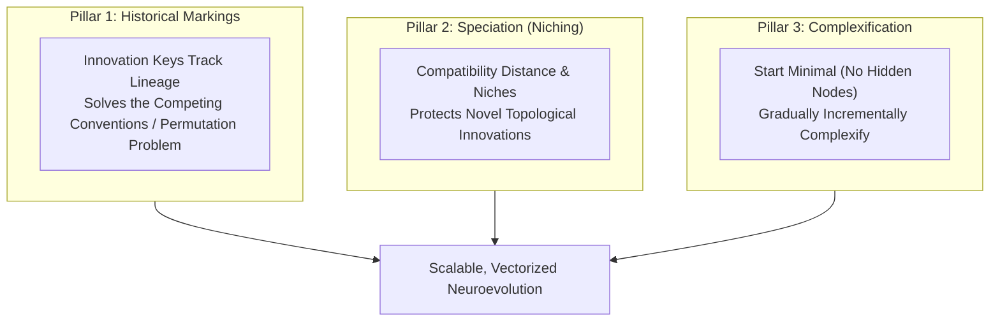
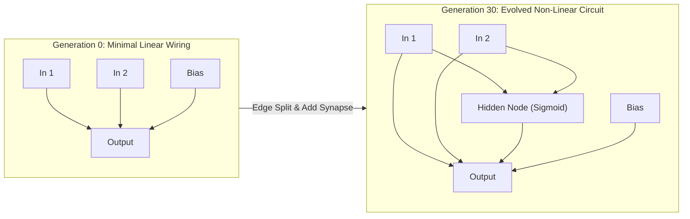

# Guide 1: NEAT Fundamentals & Complexification Dynamics

Neuroevolution of Augmenting Topologies (NEAT), originally pioneered by Kenneth O. Stanley and Risto Miikkulainen (2002), is a landmark method in artificial intelligence that evolves both the **weights** and the **graph topologies** of artificial neural networks simultaneously.

This guide explains the foundational principles of NEAT and how Malthus-NEAT executes them on modern tensorized hardware.

---

## 1. Why Evolve Topologies?

In traditional deep learning, network architectures (number of layers, neuron counts, skip connections) are manually engineered through trial and error or expensive grid searches. Gradient descent modifies synaptic weights while keeping the graph structure static.

NEAT approaches machine learning from an evolutionary perspective:
1. **Automated Neural Architecture Search (NAS)**: Architecture and parameter discovery are unified into a single search process.
2. **Minimalist Initial Conditions**: Search begins with minimal, unhidden networks (direct input-to-output connections) and only adds complexity as justified by fitness improvements.
3. **Non-Differentiable & Sparse Problems**: NEAT optimizes networks without requiring gradients, making it ideal for reinforcement learning, sparse reward domains, and symbolic feature modeling.

---

## 2. The Three Core Pillars of NEAT

Classical NEAT resolves three fundamental challenges in neuroevolution:



### Pillar 1: Historical Markings & Competing Conventions
When two disparate neural graphs cross over, their genes may express identical functional sub-circuits in completely different topological locations. Naive crossover creates mutilated networks with duplicate or missing nodes.

NEAT solves this by assigning every newly introduced gene a **historical innovation marker**. During crossover:
- Genes sharing the same innovation marker are matched and recombined.
- Disjoint and excess genes are inherited from the parent with superior fitness.

### Pillar 2: Speciation & Innovation Protection
A newly introduced structural innovation (such as a freshly inserted hidden node) initially disrupts existing functionality, temporarily degrading fitness before its weights can optimize. Without protection, natural selection would prematurely discard these innovations.

NEAT groups networks into **species** based on topological similarity:
$$\delta = c_1 \frac{E}{N} + c_2 \frac{D}{N} + c_3 \overline{|\Delta W|}$$
Within each species, individuals compete only against structural peers, allowing novel mutations the generational lifespan needed to realize their computational potential.

### Pillar 3: Starting Minimal & Complexifying
Instead of starting with large, randomly initialized deep architectures and pruning them down, NEAT initializes populations with **minimal topologies** (zero hidden units). As generations proceed, structural mutations incrementally insert synapses and intermediate processing nodes.

This guarantees that:
- The network discovered is as parsimonious as possible.
- Computation and inference times remain minimal.
- Overfitting is naturally curbed via Occam's Razor.

---

## 3. Minimal Topology to Complex Solution: XOR Example

Consider the classic non-linear XOR problem ($y = x_1 \oplus x_2$). A linear single-layer perceptron cannot solve XOR because the decision boundary is not linearly separable.



In Generation 0, Malthus-NEAT tests linear combinations, plateauing at 75% accuracy (or 0.25 MSE). As structural mutations occur:
1. An edge split mutation inserts a **hidden neuron** along an existing synaptic path.
2. Synaptic weights optimize via perturbation.
3. The resulting 3-node, 5-synapse network solves XOR to near-zero loss.

---

## 4. Minimal Code Walkthrough

```python
import numpy as np
from malthus_neat.learn import NEATClassifier

# Define the non-linear XOR truth table
X = np.array([[0.0, 0.0], [0.0, 1.0], [1.0, 0.0], [1.0, 1.0]], dtype=np.float32)
y = np.array([0, 1, 1, 0], dtype=np.int32)

# Start evolution from minimal topologies
clf = NEATClassifier(
    pop_size=50,
    max_generations=60,
    max_nodes=8,
    max_conns=16,
    random_state=42,
)
clf.fit(X, y)

print(f"XOR Solved! Accuracy: {clf.score(X, y) * 100:.1f}%")
print(f"Active Nodes: {int(np.sum(clf.best_genome_.get_active_mask()[0]))}")
```

---

## 5. Next Steps
- To inspect how Malthus-NEAT stores these structures in fixed-capacity JAX buffers, see [Guide 2: Topology Growth & Mutation](02_topology_growth_and_mutation.md).
- To embed NEAT in Scikit-Learn workflows, see [Guide 3: Scikit-Learn Estimators](03_scikit_learn_estimators.md).
