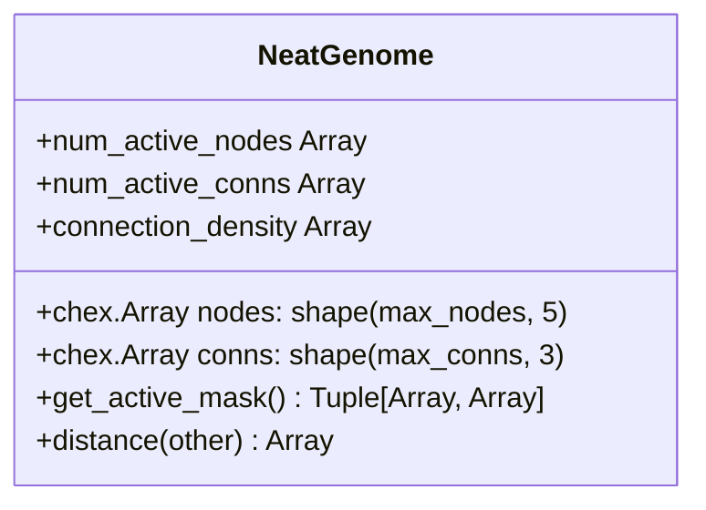
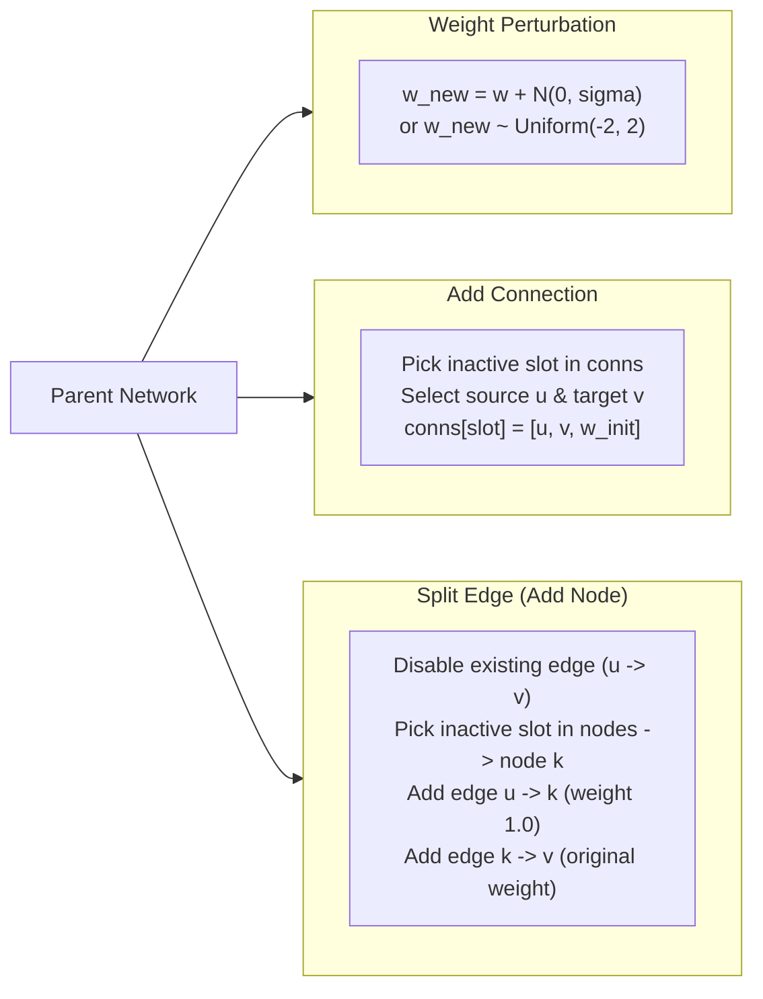

# Guide 2: Topology Growth & Structural Mutation

A major hurdle in executing NEAT on accelerators (GPUs and TPUs) is that dynamic graph structures (adding nodes, removing connections, reallocating memory) conflict with XLA's static-shape execution model.

Malthus-NEAT overcomes this through **pre-allocated static tensor buffers** and **functional masking**. This guide details how network growth and mutations occur entirely within pure, JIT-compiled tensor operations.

---

## 1. Static Buffer Anatomy

Every candidate neural network (`NeatGenome`) in Malthus-NEAT is defined by two immutable JAX float32 arrays: `nodes` and `conns`.



### The Node Buffer: `(max_nodes, 5)`
- Column 0: **Node Key** (Unique integer ID, e.g. `0, 1, 2, 104`). Inactive entries are `NaN`.
- Column 1: **Node Type** (`0 = Input`, `1 = Bias`, `2 = Hidden`, `3 = Output`).
- Column 2: **Activation Function** (Index corresponding to `sigmoid`, `tanh`, `relu`, `linear`, etc.).
- Column 3: **Aggregation Function** (Index corresponding to `sum`, `product`, `max`, etc.).
- Column 4: **Bias Weight** (Scalar learnable bias $b_i$).

### The Connection Buffer: `(max_conns, 3)`
- Column 0: **Source Node Key** ($u$). Inactive entries are `NaN`.
- Column 1: **Target Node Key** ($v$).
- Column 2: **Synaptic Weight** ($w_{uv} \in \mathbb{R}$).

---

## 2. Structural Mutations

During each evolutionary cycle, candidate networks undergo three distinct categories of mutation:



### 2.1 Connection Addition
To form a novel synaptic pathway:
1. Two non-connected active nodes $(u, v)$ are sampled (respecting topological acyclicity for feedforward networks).
2. The first available row in `conns` containing `NaN` is populated:
   $$\text{conns}[\text{idx}] \leftarrow [u, v, w_{\text{init}}]$$
3. If no inactive slots remain (`max_conns` reached), the mutation is safely dropped without error, maintaining strict buffer boundaries.

### 2.2 Edge Split (Node Insertion)
To introduce intermediate non-linear processing:
1. An active connection $u \xrightarrow{w} v$ is selected.
2. The old connection is disabled (or assigned weight 0.0).
3. An inactive row in `nodes` is allocated with a new innovation key $k$.
4. Two new connections are allocated in `conns`:
   - $u \xrightarrow{1.0} k$ (weight initialized to unity to preserve signal).
   - $k \xrightarrow{w} v$ (weight initialized to original weight $w$).
5. This minimizes disruption to existing network performance while creating a substrate for further non-linear adaptation.

### 2.3 Synaptic Weight Mutation
Active synapses undergo continuous optimization via Gaussian perturbation:
$$w_{uv} \leftarrow \begin{cases} 
w_{uv} + \mathcal{N}(0, \sigma^2), & \text{with probability } p_{\text{pert}} \\
\mathcal{U}(-B, B), & \text{with probability } p_{\text{reset}}
\end{cases}$$

---

## 3. Masking & Inactive Handling

Because tensors maintain fixed dimensions, network evaluation must ignore `NaN` rows without dynamic branch branching:
```python
import jax.numpy as jnp

def inspect_network_capacity(genome):
    # Calculate active components
    active_nodes = ~jnp.isnan(genome.nodes[:, 0])
    active_conns = ~jnp.isnan(genome.conns[:, 0])

    print(f"Allocated Nodes:    {genome.nodes.shape[0]}")
    print(f"Active Nodes:       {int(jnp.sum(active_nodes))}")
    print(f"Allocated Synapses: {genome.conns.shape[0]}")
    print(f"Active Synapses:    {int(jnp.sum(active_conns))}")
```

During matrix transformation inside `NeatInterpreter`, inactive connections are masked out by zeroing corresponding elements in the adjacency matrix $W$, ensuring they contribute zero signal during matrix multiplications.

---

## 4. Innovation Tracking & State Lifecycle

In distributed and accelerated systems, maintaining a global mutable counter for innovation numbers creates serialization bottlenecks. Malthus-NEAT uses a **generation-indexed deterministic mapping**:

```python
# Batch innovation keys based on generation counter
next_node_base = generation * pop_size + 100
new_node_keys = jnp.arange(pop_size) + next_node_base
new_conn_keys = jnp.arange(pop_size * 3).reshape(pop_size, 3) + (next_node_base * 3)
```

This guarantees:
- **Reproducibility**: Two runs with identical seeds produce bit-identical innovation lineages.
- **Pure Functionality**: No shared state across threads or GPU streams.
- **Zero Lock Contention**: All mutation keys are generated via parallel vectorized indexing.
