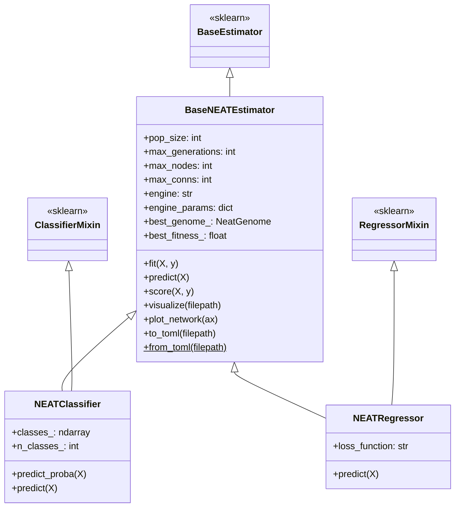

# Guide 3: Scikit-Learn Estimators

Malthus-NEAT provides full compatibility with the Python machine learning ecosystem by implementing first-class **Scikit-Learn estimators**: `NEATClassifier` and `NEATRegressor`.

Both estimators adhere strictly to the Scikit-Learn estimator contract, allowing seamless integration with `Pipeline`, `StandardScaler`, `GridSearchCV`, and model persistence pipelines.

---

## 1. Estimator Hierarchy



---

## 2. Constructor Parameter Reference

Both estimators share the primary neuroevolution parameters:

| Parameter | Type | Default | Description |
|:---|:---:|:---:|:---|
| `pop_size` | `int` | `50` | Number of candidate neural networks evolved per generation. |
| `max_generations` | `int` | `100` | Total number of evolutionary generations. |
| `max_nodes` | `int` | `20` | Static upper bound on total nodes (input + bias + hidden + output). |
| `max_conns` | `int` | `40` | Static upper bound on total synaptic connections. |
| `recurrent` | `bool` | `False` | Whether recurrent (cyclic / feedback) connections are permitted. |
| `elitism` | `int` | `2` | Number of top networks preserved unmodified between generations. |
| `engine` | `str` | `"neat"` | Evolutionary backend: `"neat"`, `"island_neat"`, `"map_elites"`, `"island_map_elites"`. |
| `engine_params` | `dict` | `None` | Optional engine dictionary (e.g. `{"num_centroids": 30}` or `{"num_islands": 4}`). |
| `random_state` | `int` | `None` | Integer seed controlling deterministic JAX PRNG initialization. |

### Classification-Specific:
- Automatically detects binary vs. multiclass targets (`n_classes_`).
- In binary classification, output is mapped through logistic sigmoid $\sigma(z) \in [0, 1]$.
- In multiclass classification, outputs are normalized through `jax.nn.softmax`.

### Regression-Specific:
- `loss_function`: Target optimization loss (`"mse"`, `"mae"`). Defaults to `"mse"`.

---

## 3. Classification Workflow

```python
from sklearn.datasets import load_breast_cancer
from sklearn.model_selection import train_test_split
from sklearn.preprocessing import StandardScaler
from sklearn.metrics import classification_report
from malthus_neat.learn import NEATClassifier

# 1. Load data
data = load_breast_cancer()
X_train, X_test, y_train, y_test = train_test_split(
    data.data, data.target, test_size=0.25, random_state=42
)

# 2. Scale features
scaler = StandardScaler()
X_train_scaled = scaler.fit_transform(X_train)
X_test_scaled = scaler.transform(X_test)

# 3. Train NEATClassifier
clf = NEATClassifier(
    pop_size=60,
    max_generations=80,
    max_nodes=35,
    max_conns=50,
    random_state=42,
)
clf.fit(X_train_scaled, y_train)

# 4. Predict probabilities & classes
probs = clf.predict_proba(X_test_scaled)
preds = clf.predict(X_test_scaled)

print("Classification Report:")
print(classification_report(y_test, preds, target_names=data.target_names))
```

---

## 4. Regression Workflow

```python
import numpy as np
from sklearn.metrics import r2_score, mean_squared_error
from malthus_neat.learn import NEATRegressor

# Non-linear synthetic regression dataset
X = np.linspace(-3.0, 3.0, 120).reshape(-1, 1).astype(np.float32)
y = (np.sinc(X[:, 0]) + 0.1 * np.random.randn(120)).astype(np.float32)

reg = NEATRegressor(
    pop_size=50,
    max_generations=100,
    max_nodes=16,
    max_conns=32,
    loss_function="mse",
    random_state=42,
)
reg.fit(X, y)

y_pred = reg.predict(X)
print(f"R² Score: {r2_score(y, y_pred):.4f}")
print(f"MSE:      {mean_squared_error(y, y_pred):.4f}")
```

---

## 5. Scikit-Learn Pipeline Integration

`NEATClassifier` and `NEATRegressor` integrate natively with Scikit-Learn's `Pipeline`:

```python
from sklearn.pipeline import Pipeline
from sklearn.preprocessing import RobustScaler
from malthus_neat.learn import NEATClassifier

pipeline = Pipeline([
    ("scaler", RobustScaler()),
    ("neat", NEATClassifier(pop_size=40, max_generations=50, random_state=123)),
])

# Fits scaler and trains NEAT network in a unified pipeline
pipeline.fit(X_train, y_train)
accuracy = pipeline.score(X_test, y_test)
print(f"Pipeline Test Accuracy: {accuracy * 100:.2f}%")
```

---

## 6. Model Persistence: TOML Serialization

Trained NEAT estimators serialize to human-readable, version-controlled TOML files that contain both hyperparameter metadata and explicit weight/topology arrays:

```python
from pathlib import Path
from malthus_neat.learn import NEATClassifier, BaseNEATEstimator

# Save trained model
model_file = Path("evolved_model.toml")
clf.to_toml(model_file)

# Load saved model without retraining
restored_model = BaseNEATEstimator.from_toml(model_file)
restored_preds = restored_model.predict(X_test_scaled)
```
