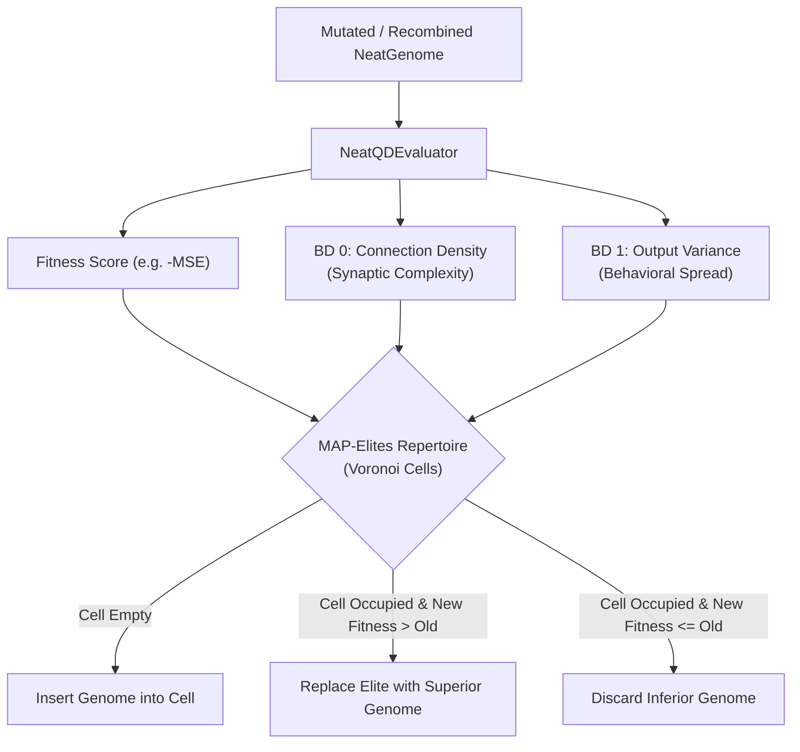

# Guide 4: Quality-Diversity (QD-NEAT & MAP-Elites)

Traditional neuroevolution optimizes toward a single objective fitness function (such as minimizing cross-entropy or mean squared error). While effective, single-objective search can converge to fragile local optima or fail to illuminate alternative architectures.

**Quality-Diversity (QD)** algorithms, notably **MAP-Elites** (Multi-dimensional Archive of Phenotypic Elites), solve this by searching for high-performing solutions across an entire grid or Voronoi tessellation of **behavioral descriptors**.

Malthus-NEAT natively integrates MAP-Elites via `NeatQDEvaluator` and the MalthusJAX engine catalog.

---

## 1. What is QD-NEAT?

In QD-NEAT, the evolutionary engine does not simply discard suboptimal networks. Instead, networks are cataloged into an archive based on their **phenotypic behavior** and **structural complexity**.



---

## 2. 2D Behavioral Descriptor Space

Malthus-NEAT equips `NeatQDEvaluator` with a 2D behavioral descriptor space:

| Descriptor | Name | Mathematical Formula | Range | Interpretation |
|:---:|:---|:---:|:---:|:---|
| **BD 0** | **Connection Density** | $\frac{\sum \mathbb{I}(\text{conn active})}{\text{max\_conns}}$ | $[0, 1]$ | Quantifies structural sparsity vs. dense synaptic connectivity. |
| **BD 1** | **Prediction Spread** | $\tanh(\sigma_{\text{predictions}})$ | $[0, 1]$ | Quantifies the dispersion/entropy of network predictions. |

This dual-descriptor space forces the evolutionary engine to discover:
1. Extremely parsimonious, sparse networks that achieve high accuracy.
2. Densely interconnected, robust architectures that achieve high accuracy.
3. Diverse operational regimes across non-linear response profiles.

---

## 3. Training with MAP-Elites

To train with MAP-Elites, specify `engine="map_elites"` and supply the number of Voronoi archive centroids via `engine_params`:

```python
import numpy as np
from malthus_neat.learn import NEATRegressor

# Non-linear dataset
X = np.linspace(-2.0, 2.0, 80).reshape(-1, 1).astype(np.float32)
y = (np.sin(3.0 * X[:, 0]) + 0.5 * np.cos(7.0 * X[:, 0])).astype(np.float32)

# Instantiate with MAP-Elites engine
qd_reg = NEATRegressor(
    pop_size=60,
    max_generations=50,
    max_nodes=16,
    max_conns=32,
    engine="map_elites",
    engine_params={"num_centroids": 40},
    random_state=42,
)
qd_reg.fit(X, y)
```

---

## 4. Inspecting & Querying the Repertoire

Once fitted, the populated archive is accessible via `.get_repertoire()`:

```python
rep = qd_reg.get_repertoire()

centroids = np.array(rep.centroids)       # Shape: (num_centroids, 2)
fitnesses = np.array(rep.fitnesses)       # Shape: (num_centroids, 1) or (num_centroids,)
descriptors = np.array(rep.descriptors)   # Shape: (num_centroids, 2)
genotypes = rep.genotypes                 # Batched NeatGenome of cell elites

# Find occupied cells
occupied_mask = ~np.isinf(fitnesses.squeeze()) & ~np.isnan(fitnesses.squeeze())
num_occupied = int(np.sum(occupied_mask))
print(f"Archive Coverage: {num_occupied} / {len(centroids)} cells ({(num_occupied / len(centroids))*100:.1f}%)")

# Extract the most parsimonious elite (lowest connection density with good fitness)
occ_indices = np.where(occupied_mask)[0]
parsimonious_idx = occ_indices[np.argmin(descriptors[occ_indices, 0])]
print(f"Most Parsimonious Elite Density: {descriptors[parsimonious_idx, 0]:.3f}")
```

---

## 5. Distributed Island MAP-Elites

For large-scale neuroevolution, Malthus-NEAT supports distributed **Island MAP-Elites** (`engine="island_map_elites"`), where multiple independent islands each maintain their own repertoire and periodically exchange elites across a migration ring:

```python
island_qd = NEATRegressor(
    pop_size=50,
    max_generations=100,
    engine="island_map_elites",
    engine_params={
        "num_islands": 4,
        "migration_interval": 20,
        "num_centroids": 50,
    },
    random_state=42,
)
island_qd.fit(X, y)
```
