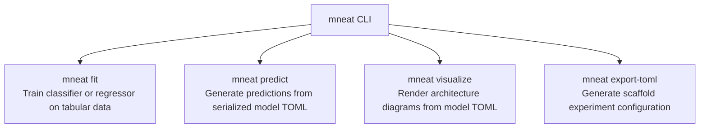

# Guide 6: CLI & TOML Orchestration (`mneat`)

Malthus-NEAT includes a production-ready command-line tool, `mneat`, designed for automated pipelines, cluster batch jobs, and reproducible experimentation without writing Python boilerplate.

---

## 1. CLI Commands Overview



---

## 2. Command Reference

### 2.1 `mneat fit`
Trains a NEAT model on CSV, TSV, or `.npy`/`.npz` datasets:

```bash
mneat fit \
  --data dataset.csv \
  --target target_column \
  --estimator classifier \
  --engine neat \
  --pop-size 80 \
  --generations 100 \
  --max-nodes 30 \
  --max-conns 60 \
  --output model.toml \
  --predict-out predictions.csv \
  --visualize-out topology.png
```

#### Key Arguments:
- `--data <path>`: Path to training data (CSV, NPY, NPZ) or `"synthetic"`.
- `--target <col_or_idx>`: Target column name or integer index (default: last column `-1`).
- `--estimator {classifier,regressor}`: Problem type (default: `classifier`).
- `--engine {neat,island,map_elites,island_map_elites}`: Evolutionary backend (default: `neat`).
- `--engine-params <key=val,...>`: Comma-separated parameters (e.g. `num_centroids=30,num_islands=4`).
- `--pop-size <int>`: Population size per generation (default: `50`).
- `--generations <int>`: Evolutionary generations (default: `100`).
- `--max-nodes <int>`: Static buffer limit for nodes (default: `20`).
- `--max-conns <int>`: Static buffer limit for synapses (default: `40`).
- `--recurrent`: Enables recurrent / cyclic feedback connections.
- `--output <path>`: Path to save trained model in TOML format.
- `--predict-out <path>`: Path to write training predictions.
- `--visualize-out <path>`: Path to save network topology visualization.

---

### 2.2 `mneat predict`
Generates predictions on new test data using a previously saved model:

```bash
mneat predict \
  --model model.toml \
  --data test_features.csv \
  --output test_predictions.csv
```

---

### 2.3 `mneat visualize`
Renders the topology of a saved model to an image or vector graphic:

```bash
mneat visualize \
  --model model.toml \
  --output network_architecture.svg \
  --format svg
```

---

### 2.4 `mneat export-toml`
Exports a clean, documented template TOML configuration for declarative orchestration:

```bash
mneat export-toml --output experiment_config.toml --estimator regressor
```

---

## 3. Declarative TOML Experiment Specification

Malthus-NEAT models and experiment setups serialize to clean, readable TOML:

```toml
[model]
estimator = "NEATClassifier"
engine = "neat"
pop_size = 60
max_generations = 100
max_nodes = 25
max_conns = 50
recurrent = false
elitism = 2
random_state = 42

[training]
best_fitness = 0.0124
n_features = 4
n_classes = 3

[genome.nodes]
# Format: [node_id, node_type, activation, aggregation, bias]
0 = [0.0, 0.0, 0.0, 0.0, 0.0]
1 = [1.0, 0.0, 0.0, 0.0, 0.0]
2 = [2.0, 3.0, 1.0, 0.0, 0.42]

[genome.conns]
# Format: [source_id, target_id, weight]
0 = [0.0, 2.0, 1.34]
1 = [1.0, 2.0, -0.89]
```

This ensures complete reproducibility across experimental runs, version control tracking for trained neural structures, and zero dependency on opaque binary pickle files.
