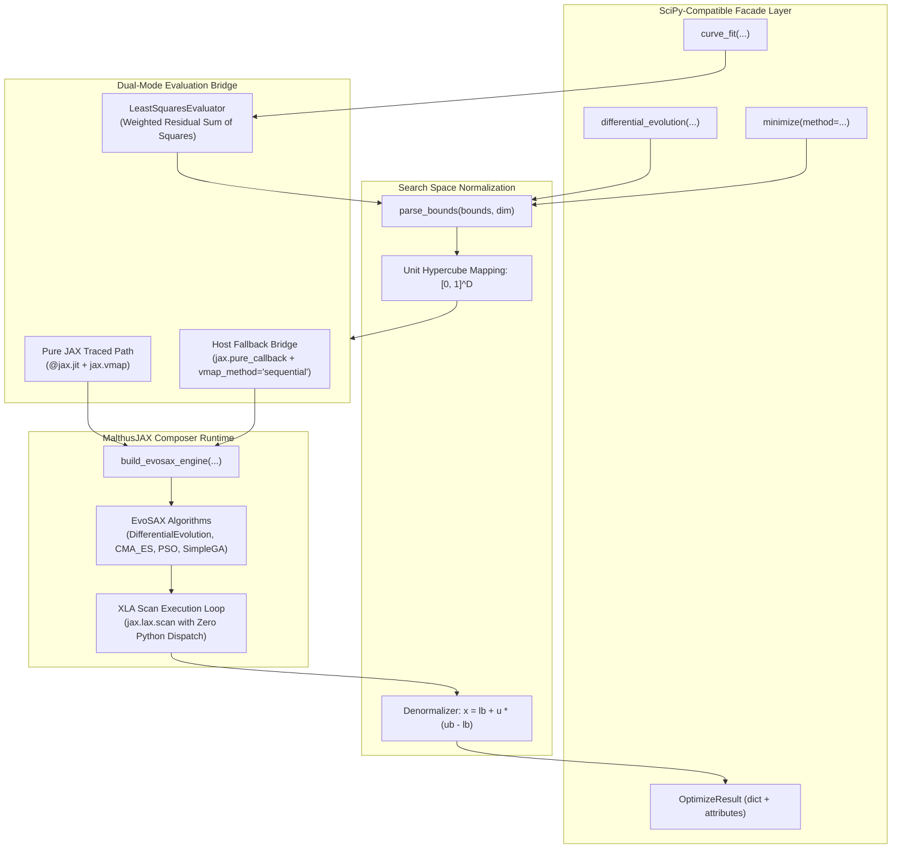

# Malthus-Optimize Architecture Specification

`malthus-optimize` bridges Python's gold-standard scientific optimization APIs (`scipy.optimize`) with JAX-native high-throughput evolutionary search. By delegating population orchestration to the **MalthusJAX Composer Engine**, it achieves hardware acceleration across CPUs, GPUs, and TPUs without requiring users to rewrite legacy NumPy objective functions.

---

## 1. High-Level System Architecture



---

## 2. Core Subsystems

### 2.1 Search Space Normalization (`core/bounds.py`)
EvoSAX strategies (such as `DifferentialEvolution` and `CMA_ES`) require a bounded or unit-scaled domain to maintain numerical stability in mutation operators and covariance updates.

- **`ParsedBounds`**: Encapsulates lower bounds, upper bounds, widths ($\Delta = \text{ub} - \text{lb}$), and dimension $D$.
- **Unified Format Parser**: Accepts:
  1. Sequence of `(min, max)` tuples: `[(-5.0, 5.0), (-2.0, 2.0)]`
  2. 2-tuple of sequences / arrays: `([-5.0, -2.0], [5.0, 2.0])`
  3. `scipy.optimize.Bounds` instances
- **Scaling Equations**:
  $$\mathbf{u} = \frac{\mathbf{x} - \mathbf{lb}}{\mathbf{ub} - \mathbf{lb}} \in [0, 1]^D, \quad \mathbf{x} = \mathbf{lb} + \mathbf{u} \odot (\mathbf{ub} - \mathbf{lb})$$

### 2.2 Dual-Mode Objective Evaluation (`evaluators/scipy_evaluator.py`)
Scientific objectives in Python range from JAX expressions to black-box legacy C/Fortran/NumPy routines. `malthus-optimize` implements automatic tracing detection:

```python
# Tracing Probe
try:
    test_out = objective_fn(test_x, *args)
    if isinstance(test_out, jax.Array):
        is_jax_traceable = True
except Exception:
    is_jax_traceable = False
```

1. **Pure JAX Mode**:
   When the objective is traceable, candidate evaluations are directly vectorized via `jax.vmap` and fused into the XLA compilation graph.
2. **Host Fallback Mode (`jax.pure_callback`)**:
   When the objective invokes non-JAX libraries (NumPy, SciPy, PyTorch, CFFI, or file I/O), candidate solutions are evaluated via `jax.pure_callback(..., vmap_method="sequential")`. This allows the outer loop to compile inside `jax.lax.scan` without tracer leak errors or broken gradient tapes.

### 2.3 Least Squares Evaluator (`evaluators/least_squares_evaluator.py`)
Designed specifically for `curve_fit`, this evaluator computes the weighted sum-of-squared residuals:
$$\mathcal{L}(\mathbf{p}) = \frac{1}{2} \sum_{i=1}^N \left( \frac{f(\mathbf{x}_i, \mathbf{p}) - y_i}{\sigma_i} \right)^2$$
It handles multi-dimensional inputs $\mathbf{x} \in \mathbb{R}^{N \times D}$, scalar or 1D parameter vectors $\mathbf{p}$, and measurement uncertainties $\sigma_i$.

### 2.4 Composer Bridge (`composer/bridge.py`)
`malthus-optimize` delegates execution to `malthusjax.composer.adapters.evosax_adapter`:
- **`build_evosax_engine`**: Instantiates a `UniversalAdapterEngine` encapsulating population initialization, perturbation, evaluation, and selection.
- **Strategy Mapping**:
  - `'de'` / `'differential_evolution'` $\rightarrow$ `evosax.algorithms.DifferentialEvolution`
  - `'cmaes'` / `'cma_es'` $\rightarrow$ `evosax.algorithms.CMA_ES`
  - `'pso'` $\rightarrow$ `evosax.algorithms.PSO`
  - `'ga'` / `'genetic_algorithm'` $\rightarrow$ `evosax.algorithms.SimpleGA`
  - `'open_es'` $\rightarrow$ `evosax.algorithms.OpenES`
- **JIT Execution**: The evolutionary loop runs via XLA-compiled `scan_loop`, executing hundreds of generations in milliseconds without round-trip Python interpreter latency.

### 2.5 Covariance & Uncertainty Quantification (`api/curve_fit.py`)
To match `scipy.optimize.curve_fit`, `malthus-optimize` computes parameter uncertainties:
1. **Numerical Jacobian ($J \in \mathbb{R}^{N \times P}$)**: Forward finite differences at the optimal parameter vector $\mathbf{p}^*$:
   $$J_{i, j} = \frac{f(\mathbf{x}_i, \mathbf{p}^* + \epsilon \mathbf{e}_j) - f(\mathbf{x}_i, \mathbf{p}^*)}{\epsilon}, \quad \epsilon = \sqrt{\epsilon_{\text{mach}}} \cdot \max(1, |\mathbf{p}^*_j|)$$
2. **Curvature Matrix ($J^T W J$)**: Weighted by $W = \text{diag}(1 / \sigma_i^2)$.
3. **Covariance Matrix ($P_{\text{cov}}$)**:
   $$P_{\text{cov}} = (J^T W J)^{-1} \cdot s_r^2$$
   where $s_r^2 = \frac{\sum r_i^2}{N - P}$ when $\sigma$ is unnormalized, matching SciPy conventions.

---

## 3. Memory & Execution Guarantees

| Metric | Pure Python / SciPy | Malthus-Optimize (Pure JAX) | Malthus-Optimize (NumPy Fallback) |
| :--- | :--- | :--- | :--- |
| **Execution Loop** | Python `while` loop | `jax.lax.scan` (XLA Tape) | `jax.lax.scan` + `pure_callback` |
| **Population Dispatch** | Serial or `multiprocessing` | Single fused GPU/TPU kernel | Vectorized / sequential callback |
| **Memory Footprint** | Object allocation per individual | Static pre-allocated JAX buffers | Static buffers + temporary numpy view |
| **GPU / TPU Capable** | No (CPU only) | Yes (100% native) | Outer loop on device, evaluation on host |
