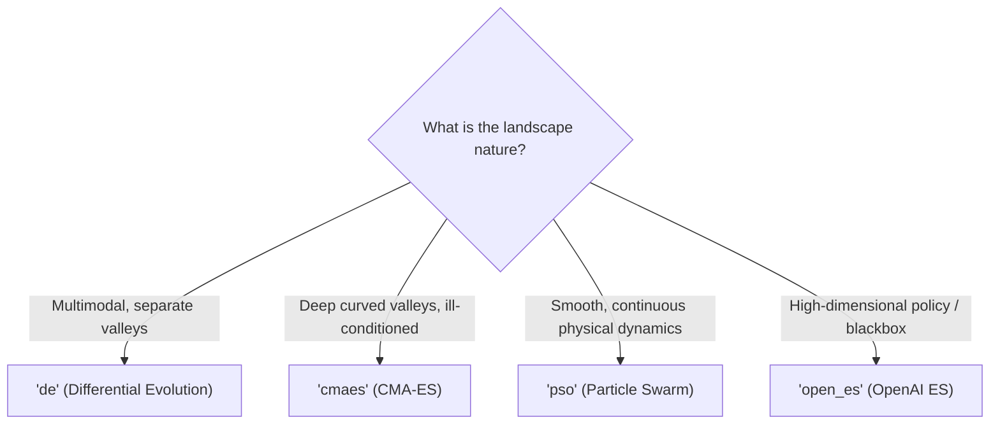

# User Guide 3: Multi-Strategy Optimization with `minimize()`

`malthus_optimize.minimize()` provides a unified entry point to state-of-the-art evolutionary algorithms implemented in MalthusJAX Composer and EvoSAX.

---

## 1. Supported Optimization Methods

| Method | Canonical Algorithm | Ideal Domain | Key Characteristics |
| :--- | :--- | :--- | :--- |
| `'de'` / `'differential_evolution'` | Differential Evolution | Non-convex, multimodal | Vector difference mutations, parameter independent. |
| `'cmaes'` / `'cma_es'` | Covariance Matrix Adaptation ES | Ill-conditioned, curved valleys | Adapts full covariance matrix of mutations; invariant to rotations. |
| `'pso'` | Particle Swarm Optimization | Swarm physics, non-linear kinetics | Cognitive & social acceleration toward historical personal/global bests. |
| `'ga'` / `'genetic_algorithm'` | Simple Genetic Algorithm | Exploratory, rugged landscapes | Gaussian mutations, elitist tournament selection. |
| `'open_es'` | OpenAI Evolution Strategy | High dimensions, RL policies | Natural evolution strategy using score function gradient estimates. |

---

## 2. Choosing the Right Method



---

## 3. Comparative Usage Example

```python
import numpy as np
from malthus_optimize import minimize

# 5D Rosenbrock ("Banana") Valley
def rosenbrock(x):
    return sum(100.0 * (x[1:] - x[:-1]**2.0)**2.0 + (1.0 - x[:-1])**2.0)

bounds = [(-5.0, 5.0)] * 5

# 1. Solve with CMA-ES (Excels at navigating curved Rosenbrock valleys)
res_cmaes = minimize(
    fun=rosenbrock,
    method="cmaes",
    bounds=bounds,
    options={"pop_size": 30, "max_generations": 200, "seed": 42},
)
print("CMA-ES Result:", res_cmaes.fun)

# 2. Solve with Particle Swarm Optimization
res_pso = minimize(
    fun=rosenbrock,
    method="pso",
    bounds=bounds,
    options={"pop_size": 40, "max_generations": 200, "seed": 42},
)
print("PSO Result:   ", res_pso.fun)

# 3. Solve with Differential Evolution
res_de = minimize(
    fun=rosenbrock,
    method="de",
    bounds=bounds,
    options={"pop_size": 30, "max_generations": 200, "seed": 42},
)
print("DE Result:    ", res_de.fun)
```

---

## 4. Options Dictionary Configuration

The `options` dict allows fine-tuning strategy execution:

```python
options = {
    "pop_size": 50,          # Population size
    "max_generations": 150,  # Generation budget
    "seed": 2026,            # Random seed
    "strategy_params": {     # Algorithm-specific hyperparameters
        # E.g. for DE:
        "differential_weight": 0.8,
        "crossover_rate": 0.9,
    }
}
```
