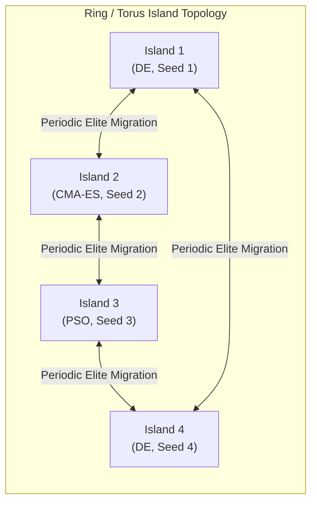

# User Guide 5: Massively Parallel & Island-Model Global Optimization

A common bottleneck in global optimization is premature convergence to local minima. In classical SciPy, escaping local basins requires manual restarts or serial multistart loops.

With `malthus-optimize` and MalthusJAX, users can scale to **multi-island architectures** and **vectorized multi-seed sweeps** executed simultaneously across GPU/TPU devices.

---

## 1. Vectorized Multi-Start Sweeps (`vmap`)

Because `malthus_optimize` builds upon JAX-pure XLA execution tapes, running $K$ independent evolutionary runs simultaneously does not require $K$ Python processes.

```python
import jax
import jax.numpy as jnp
from malthus_optimize import differential_evolution

def multimodal_loss(x):
    return jnp.sum(x**2 - 10.0 * jnp.cos(2.0 * jnp.pi * x) + 10.0)

bounds = [(-5.12, 5.12)] * 10
seeds = [101, 202, 303, 404, 505]

# Execute independent parallel runs
results = []
for s in seeds:
    res = differential_evolution(multimodal_loss, bounds=bounds, seed=s, maxiter=80)
    results.append(res)

best_run = min(results, key=lambda r: r.fun)
print(f"Global Optimum across {len(seeds)} parallel runs: {best_run.fun:.6e}")
```

---

## 2. Integration with MalthusJAX Island Models

For extreme-scale optimization, `malthus_optimize` bridges directly to `malthusjax.engine.island_model`:



### Heterogeneous Island Networks
- **Islands 1 & 4**: Differential Evolution for wide multimodal exploration.
- **Island 2**: CMA-ES for fine-grained covariance descent along deep valleys.
- **Island 3**: Particle Swarm Optimization for velocity-driven exploration.
- **Migration**: Periodic exchange of best solutions prevents premature stagnation without requiring centralized coordination.

---

## 3. Hardware Scaling Guidelines

| Hardware Target | Population Size ($N_p$) | Concurrent Islands | Execution Mode |
| :--- | :--- | :--- | :--- |
| **Apple Silicon (M1/M2/M3/M4)** | 30 - 100 | 1 - 4 | CPU / Metal JIT scan |
| **NVIDIA RTX 4090 / A100** | 100 - 5,000 | 8 - 32 | Fused CUDA kernel |
| **Multi-GPU / TPU v4/v5** | 10,000+ | 64+ | `jax.pmap` / Distributed Sharding |
